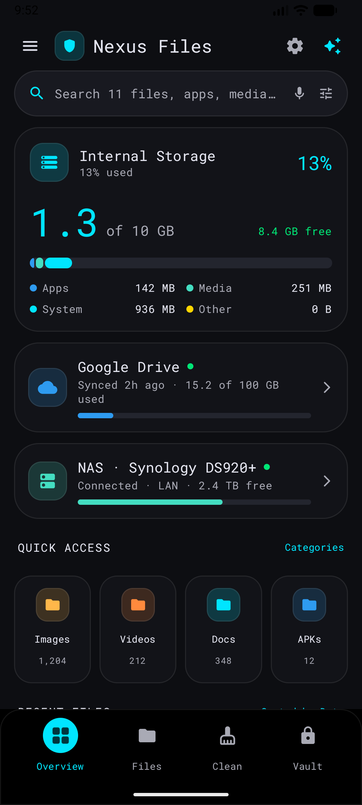
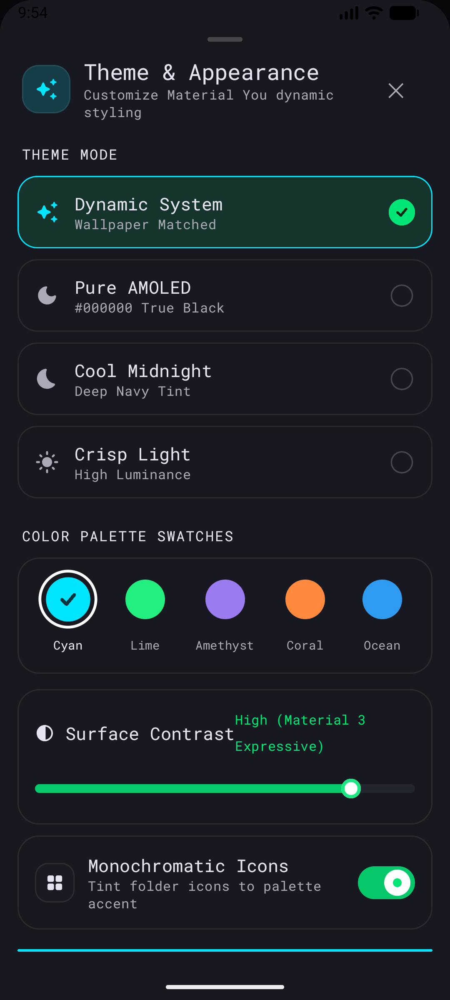
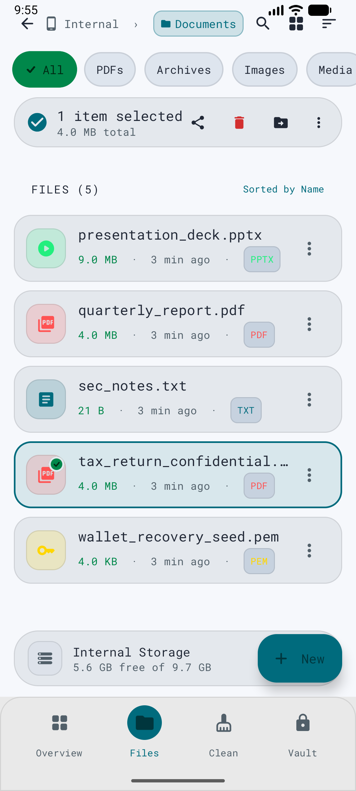
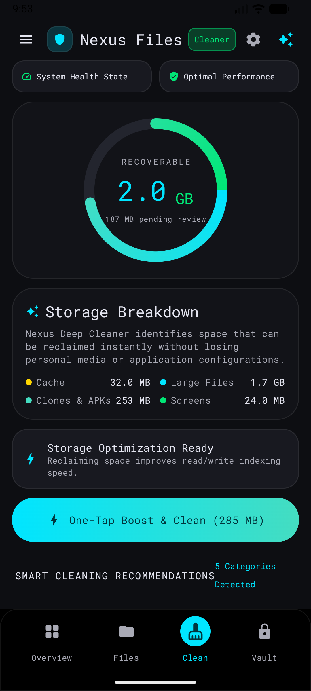
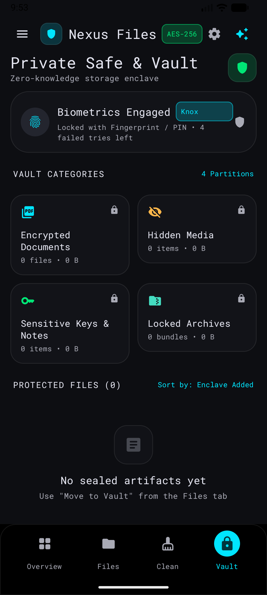
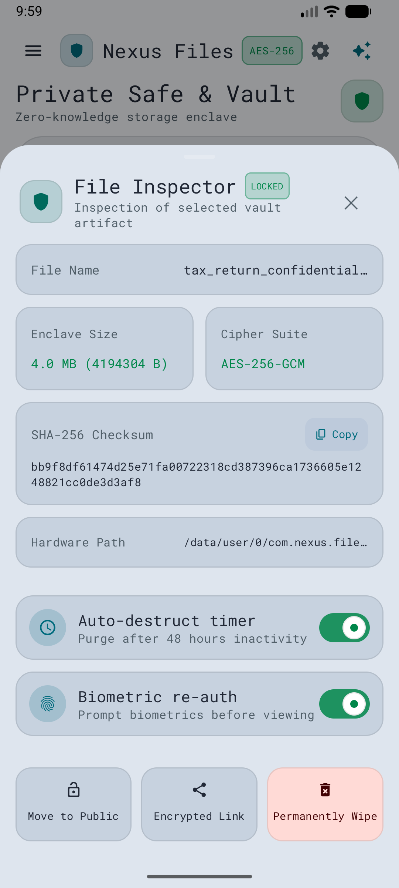

# Nexus Files

A modern Android file manager built with **Kotlin** and **Jetpack Compose**, following the
*Nexus Expressive Material* design system — surgical precision, fluid speed and a whole lot
of motion design.

| Overview | Theme & Appearance |
|---|---|
|  |  |

| Files & Selection | Storage Cleaner |
|---|---|
|  |  |

| Secure Vault | File Inspector |
|---|---|
|  |  |

## Features

**Overview**
- Live internal-storage stats with an animated segmented category bar (Apps / Media / System / Other)
- Count-up storage readouts, quick-access category tiles with real file counts, recent files
- Cloud source cards (Google Drive, NAS) with usage meters

**Files**
- Real browsing of shared storage (All-files access), breadcrumbs, filter chips, sort menu
- List **and** grid modes with live image thumbnails and gradient scrims
- Multi-select with spring-animated check badges, share / delete / move, rename, new folder
- "Move to Vault" seals any file into the encrypted enclave

**Cleaner**
- Real analysis: junk & cache patterns, MD5-verified duplicate binaries, >500 MB unused files,
  stale APK installers, screenshots older than 6 months
- Animated recovery gauge, one-tap boost & clean, per-category actions (all deletions are real)

**Vault**
- Genuine **AES-256-GCM** encryption backed by an AndroidKeyStore hardware key
- PIN lock (salted SHA-256) with shake-on-failure feedback
- File Inspector: enclave size, cipher suite, real SHA-256 checksum, hardware path,
  auto-destruct timer, biometric re-auth toggles, restore / encrypted link / permanent wipe

**Theming**
- 4 theme modes (Dynamic System, Pure AMOLED, Cool Midnight, Crisp Light)
- 5 accent palettes (Cyan, Lime, Amethyst, Coral, Ocean) × surface-contrast slider × monochrome icons
- The entire app **animates** between appearances (every color is `animateColorAsState`)

## Motion design

Springy press feedback everywhere, staggered list entrances, donut gauge sweep, count-up
numbers, chip morphs with hand-drawn ticks, switch thumbs that stretch while pressed,
bubble navigation indicator, slide-through tab transitions, sheet springs, dialog pops,
PIN shake, and sliding toasts.

## Tech stack

| | |
|---|---|
| Language | Kotlin 2.4.21 |
| UI | Jetpack Compose (BOM 2026.09.00) + Material 3 |
| Build | AGP 9.5.0 · Gradle 9.6.0 |
| Fonts | Roboto Flex · Inter · Roboto Mono |
| Storage | DataStore Preferences |
| Crypto | AndroidKeyStore AES-256-GCM |
| Images | Coil 3 |

## Build

```bash
./gradlew assembleDebug      # debug APK
./gradlew assembleRelease    # signed release APK (needs keystore.properties, see below)
```

Release signing: create `keystore.properties` in the project root:

```properties
storeFile=/path/to/your.keystore
storePassword=…
keyAlias=…
keyPassword=…
```

Without it the release build falls back to debug signing so a fresh clone still builds.

## Install

Download the APK from the [Releases](../../releases) page and install it on Android 10+
(API 29). Grant **All files access** when prompted to enable full file management.

## Design reference

The UI follows `stitch_modern_android_file_manager/` — the Nexus Expressive Material design
system (Material 3 Expressive, squircle geometry, Electric Cyan / Material Teal / Emerald
semantic indicators).
